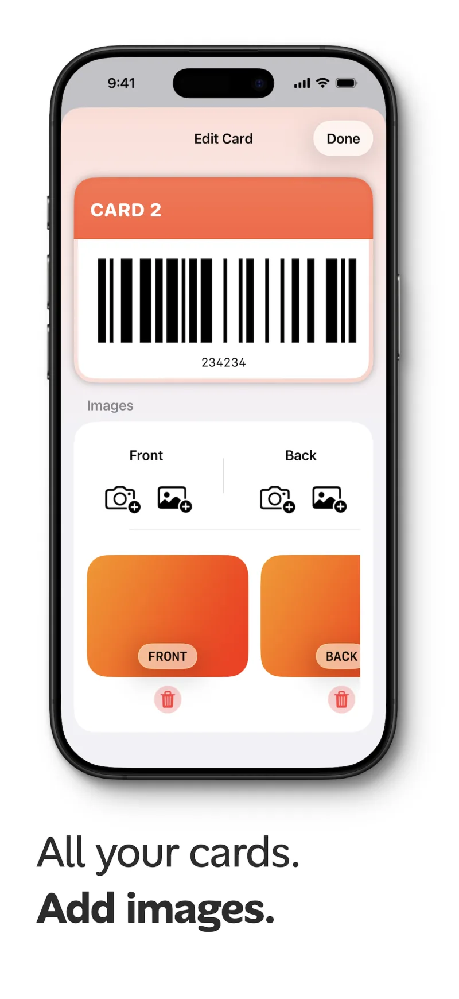

## What you need

- PassCollect installed on your iPhone ([download it free](https://apps.apple.com/app/passcollect-store-cards/id6738351871))
- The physical card, or a photo of it

You don't need an account. See [why PassCollect works without one](/blog/store-loyalty-cards-iphone-without-account/).

## Step 1: Scan the barcode

1. Open PassCollect and tap the **+** button in the top-right corner of the card list.
2. Point your camera at the card's barcode. PassCollect reads it instantly.
3. If you don't have the card with you, upload a photo of it instead.

PassCollect allows camera access only so it can scan inside the app. No images or data leave your device. See the [privacy policy](/privacy/).

## Step 2: Check the card details

After scanning, the **Edit Card** screen opens with a live preview of your card at the top. Under **Card details**, you can change:

| Field | What it's for |
|---|---|
| Name | The label shown on the card, such as the store's name |
| Number | The number encoded in the barcode, filled in from the scan |
| Logo | An optional logo for the card |
| Barcode Type | The barcode format, for example Code 128 |
| Card color | The color of the card in your list |

Tap **Done** to save the card.

## Step 3 (optional): Add front and back images

Some cards have useful information printed on them, like a member number or an expiry date. In the **Images** section of the Edit Card screen, you can add a **Front** and a **Back** image. Each one can come from the camera or from your photo library. Tap the trash icon under an image to remove it.

## Tips for a clean scan

- Hold the phone steady and parallel to the card.
- Make sure the whole barcode is in view and well lit.
- If a scan picks the wrong format, change **Barcode Type** on the Edit Card screen.

## What to do next

- [Show the card on your Apple Watch](/blog/loyalty-cards-apple-watch/)
- [Add a Lock Screen shortcut or Home Screen widget](/blog/lock-screen-shortcuts-home-screen-widgets/) so the card is one tap away
